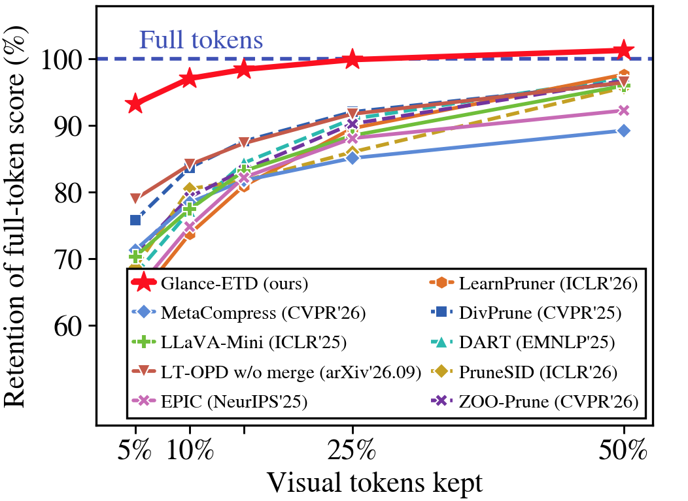
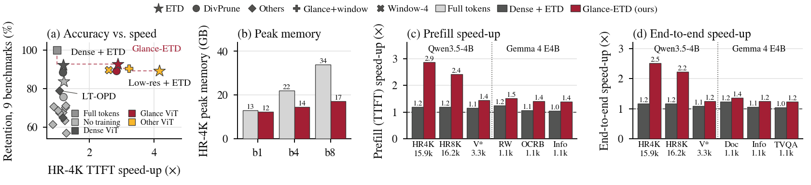
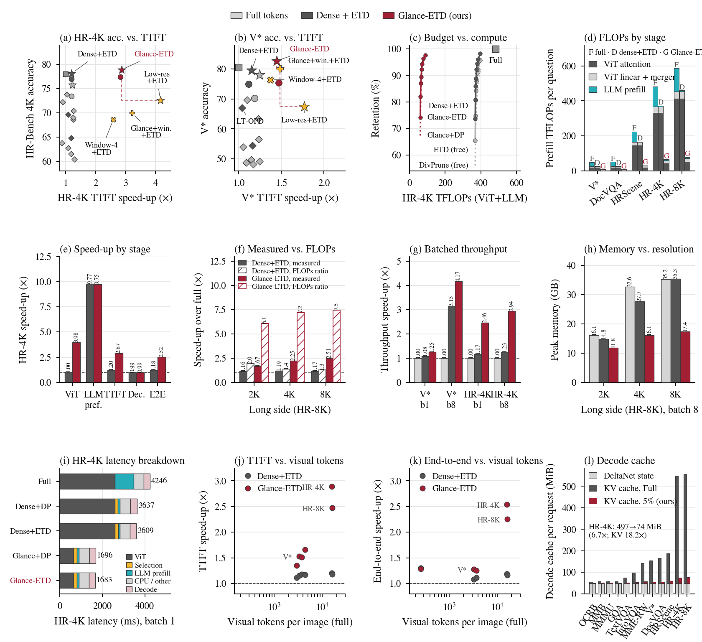
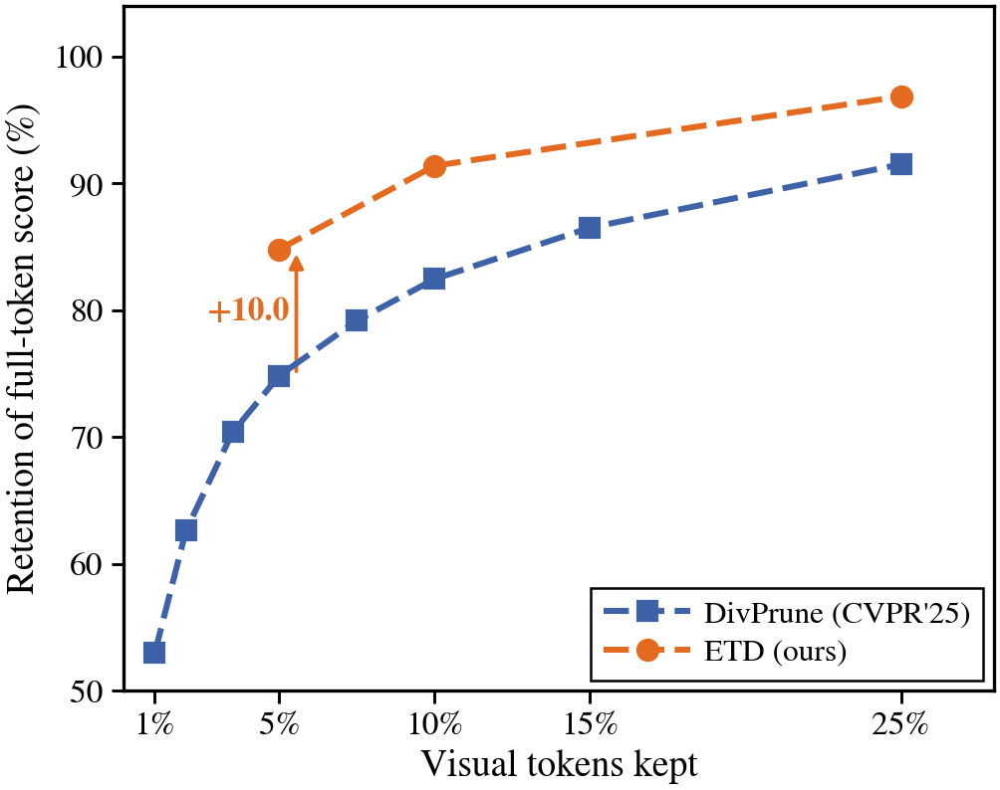

# Glance, then Select: Evidence-Tempered Visual Token Selection for Extremely Compressed Multimodal LLMs

**Yuxuan Wang**<sup>1</sup>, Guangxiang Zhao<sup>2</sup>, Yuxuan Tian<sup>1</sup>, Yahui Han<sup>1</sup>, Xinyu Tan<sup>1</sup>, Feiyu Wang<sup>1</sup>, Zongwei Lv<sup>1</sup>, Xiangzheng Zhang<sup>2</sup>, Lin Sun<sup>2</sup>, Tong Yang<sup>1</sup>

<sup>1</sup>Peking University &nbsp; <sup>2</sup>Qiyuan Tech

Submitted to CVPR 2027. [Project page](https://yxwang1215.top/papers/glance-etd/)

A high-resolution image becomes thousands of visual tokens, and those tokens dominate prefill. At a strict 5% budget the language model sees about one token in twenty, but two costs remain: the vision encoder still processes every patch, and the few surviving tokens can miss the region that holds the answer. Glance-ETD uses one small question-conditioned scorer for both decisions. A glance encoder reads a low-resolution view and re-encodes only the question-relevant regions at native resolution. Evidence-Tempered Diversity (ETD) then keeps the final tokens by combining DivPrune's max–min distance with the scorer's evidence map.

With 5% of the visual tokens, Glance-ETD retains **91.6%** of the full-token performance of Qwen3.5-4B across fourteen benchmarks. That is 17.3 points above LT-OPD and 6.0 points above the same training recipe with DivPrune. On 4K images it shortens time to first token by **3.1×**. The same comparison holds on Gemma 4 E4B, GLM-4.6V-Flash, and InternVL3.5-8B, with the largest gains on text-rich tasks.

<p align="center">
  
</p>

*Training and inference. The student is distilled toward a frozen full-token teacher while it selects with DivPrune. The scorer is trained separately on box targets. At inference it picks the top 25% of coarse cells, and ETD keeps `K = ⌈0.05 N⌉` tokens with exponent γ = 0.25.*

## Two limits at 5%

Pruning after the vision encoder shortens the language-model prefill, but on HR-Bench 4K the encoder is still most of the time to the first token. Diversity selection spreads the budget over the scene and often drops a street sign or a phone number. Relevance selection finds the text and drops the surrounding context. Glance-ETD is built so the encoder spends native resolution where the question points, and the token selector keeps both that evidence and the rest of the scene.

<p align="center">
  
</p>

*Left: on HR-Bench 4K, pruning after the vision encoder still spends 2.59 s in the encoder; the glance encoder cuts that stage to 0.65 s. Middle: on one TextVQA image, DivPrune keeps 1 of 10 text tokens, relevance top-K keeps all 10 but little context, and ETD keeps 4 plus context. Right: on 4,123 TextVQA validation questions, bars are the share of tokens that overlap the answer box and diamonds are the share of questions that keep at least one.*

## Method

One scorer, `f_φ`, about 1.9M parameters, reads the visual tokens and the question and outputs a relevance logit for every visual token. It is trained once, with the MLLM frozen, by a listwise loss on box-coverage targets. TextVQA answers are grounded on TextOCR word boxes and merged with Visual-CoT boxes. The same scorer is shared by every Qwen checkpoint.

**Stage 1, glance.** The image is average-pooled 2×2 and encoded at a quarter of the patches. The scorer keeps the 25% of coarse cells with the highest question relevance. Only those cells are re-encoded at native resolution; every other cell copies its coarse token onto the native grid. The grid still has all `N` positions, so any post-encoder selector applies unchanged, and the encoder costs about a sixth of a dense ViT. Images below 4096 patches are encoded densely. During training the cells are chosen by max–min diversity, so the MLLM does not depend on the scorer. At inference the scorer chooses the cells.

**Stage 2, ETD.** DivPrune starts from the token farthest from the mean and greedily adds

```text
i* = argmax_{i not in S}  d_i,    d_i = min_{j in S} (1 - cos(x_i, x_j))
```

until `|S| = K`. ETD keeps that loop and multiplies the distance by the relative evidence:

```text
i* = argmax_{i not in S}  d_i · (N p_i)^γ,    γ = 0.25
```

`p` is a softmax over the scorer logits. A flat map returns DivPrune. A peaked map moves the selection toward the answer without dropping the rest of the scene. The strict budget is `K = ⌈0.05 N⌉` on every image. Floor-32, `K = max(32, ⌈0.05 N⌉)`, and the label-free rule `K ∝ N^0.45` are the other budgets in the paper. Kept tokens go to the LLM with their original M-RoPE positions.

**Training.** The MLLM and the glance encoder are trained together by on-policy self-distillation for 175 steps on LT-OPD-14K-spatial. The student rolls out with DivPrune at 5% and is distilled token by token toward a frozen copy of itself that sees every token. The vision-tower learning rate is 2e-6, ten times the LT-OPD default. The scorer is not updated in this stage.

## Results

Two averages appear below, and they are not the same number. **91.6%** is the mean retention over the fourteen-benchmark suite (the nine LT-OPD benchmarks plus V\*, HR-Bench 4K/8K, DocVQA, and InfoVQA). **93.3%** is the mean over the nine LT-OPD benchmarks only, which is what the budget plot reports. Retention is each score divided by that model's own non-thinking full-token score.

| Setting | Retention | Comparison |
|---|---:|---|
| Glance-ETD, 14 benchmarks, strict 5% | 91.6 ± 0.3% | +17.3 vs. LT-OPD, +6.0 vs. the same recipe with DivPrune |
| Glance-ETD, 9 benchmarks, strict 5% | 93.3% | +17.5 vs. DivPrune; mean of three training seeds |
| Frozen MLLM + ETD, 14 benchmarks | 82.0% | +10.7 vs. DivPrune, the strongest training-free baseline |
| Same recipe, DivPrune, 14 benchmarks | 85.6% | ETD on that recipe reaches 90.5% before the glance encoder |
| HR-Bench 4K time to first token | 3.09× | ViT time 2.60 s → 0.57 s; prefill 482 → 65 TFLOPs |

Inside the 10× learning-rate recipe, ETD adds 3.7 points on the dense encoder (92.5% on the nine-benchmark mean) and the glance encoder adds 0.8 more (93.3%) while cutting HR-Bench 4K prefill from 373 to 65 TFLOPs and time to first token from 3318 to 1283 ms. Setting γ = 0 makes ETD identical to DivPrune and costs 2.9 points, mostly on reading. Setting γ = 64 keeps only the highest-evidence tokens and costs 3.6 points, because the same words are kept several times and the rest of the scene is missed. On TextVQA, ETD keeps a token inside the answer box for 99.1% of questions, against 80.2% for DivPrune.

### Budget

Solid lines are trained models. Dashed lines are training-free and run on the released model. At 5% of the tokens, Glance-ETD is the mean of three seeds; the other budgets use one seed.

<p align="center">
  
</p>

*Nine-benchmark retention on Qwen3.5-4B. At 5%, Glance-ETD keeps 93.3% of the full-token score, 17.5 points above DivPrune.*

### Efficiency

Measured on one A800 in bf16. Glance-ETD is the point that keeps high retention and a large speed-up on HR-Bench 4K. Selectors that prune only after a dense encoder stay near 1×, because the encoder is still the bottleneck. Batch-8 peak memory on HR-Bench 4K drops from 34.7 GB to 17.7 GB, and batch-8 throughput is 2.94× higher. End-to-end time on HR-Bench 4K is 2.69× shorter. On the six benchmarks whose images fall below the 4096-patch glance threshold, time to first token is 0.87–0.90× the full-token run.

<p align="center">
  
</p>

*Strict 5%. (a) Nine-benchmark retention against HR-Bench 4K time-to-first-token speed-up. (b) HR-Bench 4K peak memory at batch 1, 4, and 8. (c)(d) Prefill and end-to-end speed-up on the benchmarks with the largest gain. Token counts under the labels are the mean visual tokens of the full model.*

<p align="center">
  
</p>

*More of the same measurements: task-matched accuracy against speed on HR-Bench 4K and V\*, prefill FLOPs as the budget goes from 1% to 25%, a stage breakdown, throughput, peak memory, and the decode cache.*

### Other models

Each model has its own scorer, trained on the same box data from that model's features, and is self-distilled with the same recipe. ETD leads DivPrune on every model, by 8.0–13.0 points when the MLLM is frozen and by 3.7–12.0 points after self-distillation. Glance-ETD stays above self-distillation with DivPrune on all four, and within 2.4 points of the dense encoder.

<p align="center">
  
</p>

*Nine-benchmark retention at strict 5%. SD is self-distillation with the dense encoder. Glance-ETD is 93.3% on Qwen3.5-4B, 91.1% on Gemma 4 E4B, 88.2% on GLM-4.6V-Flash, and 83.8% on InternVL3.5-8B.*

On Gemma 4 E4B-it the same gap shows up across budgets. With the MLLM frozen, ETD keeps 78.6% at strict 5% on the fourteen-benchmark suite, 11.8 points above DivPrune. On the nine-benchmark curve below, ETD at 10% matches DivPrune at 25%.

<p align="center">
  
</p>

*Gemma 4 E4B-it against its own full-token scores. Every marker averages the nine benchmarks, and both methods pass the same number of tokens per image.*

## Repository

| Path | Contents |
|---|---|
| `glance_etd/etd.py` | DivPrune greedy, ETD weights `(N p)^γ`, strict / floor-32 / `K ∝ N^0.45` budgets. |
| `glance_etd/scorer.py` | Evidence scorer, box-coverage targets, listwise loss. |
| `glance_etd/glance.py` | Two-pass glance encoder. Training uses diversity cells; inference uses the scorer's top cells. |
| `glance_etd/teacher_kl.py` | Teacher-KL cost of a kept subset, the diagnostic used to choose γ. |
| `scorer/` | TextVQA/TextOCR grounding, Visual-CoT merge, and scorer training. |
| `training/ltopd_glance_etd.patch` | Patch for the public [LT-OPD](https://github.com/Yrxxxxxxxx1007/LT-OPD) release. |
| `training/configs/` | Final recipe and its seeds, the dense-encoder variant, the learning-rate ablations, and ETD-trained glance. |
| `training/build_spatial_train.py` | Builds LT-OPD-14K-spatial. |
| `inference/` | Full inference pipeline and the label-free scale of `K ∝ N^0.45`. |
| `tests/` | CPU checks of the reference implementation. |
| `assets/` | The figures above. |

`glance_etd/` needs only PyTorch. The patch, `scorer/`, and `inference/` reproduce the experiments on top of the public LT-OPD code. The reference functions were checked on CPU against the code used for the paper: DivPrune and ETD selection, the scorer forward pass, and the glance encoder under both cell rules. Model checkpoints are not in this repository.

## Quick check

Tested with PyTorch 2.6. The tests compare ETD with a brute-force reference, check that uniform evidence returns DivPrune, and check the glance output layout on a toy tower.

```bash
pip install torch
python tests/test_reference.py
```

```python
import torch
from glance_etd import EvidenceScorer, etd_select, strict_budget

tokens = torch.randn(1200, 2560)   # post-merger visual tokens, raster order (30 x 40)
question = torch.randn(12, 2560)   # input embeddings of the question
scorer = EvidenceScorer().eval()   # or EvidenceScorer.load("selector_epoch3.pt")
rows, cols = torch.arange(1200) // 40, torch.arange(1200) % 40
relevance, _ = scorer(tokens, question, rows, cols, 30, 40)
keep = etd_select(tokens, relevance, strict_budget(1200))   # 60 sorted indices
```

`tokens[keep]` is what the language model should see, together with the original positions of those indices.

## Reproducing the experiments

Training used 8×A800 and took about 4.7 hours for 175 steps. Evaluation used 4×A800. The environment is that of the public LT-OPD release: Qwen3.5-4B, `transformers` with Qwen3.5 support, `flash-attn`, and verl/FSDP with Ray.

**1. Code base.** Apply the patch from the LT-OPD source root, the directory that contains `learnable_merge/`, `lt_opd/`, and `evaluation/`:

```bash
cd LT-OPD/src && patch -p1 < /path/to/Glance-ETD/training/ltopd_glance_etd.patch
```

The patch also keeps training-side options used by the supplementary ablations (`importance.*`, `opd_variant`, and the window encoder). They are off by default. Each recipe sets the options it uses.

**2. Data.** LT-OPD-14K comes from the LT-OPD release. Spatial multiple-choice rows come from the SAT static split and COCO train2017 instances. Images used by GQA test-dev, POPE, MME, and CV-Bench are excluded. The script writes `DATA/data/LT-OPD-14K-spatial` (12.5K rows from LT-OPD-14K and 1.5K spatial rows).

```bash
LTOPD_DATA_ROOT=DATA LTOPD_SRC=LT-OPD/src python training/build_spatial_train.py
```

**3. MLLM.** Train the final recipe, then export the step-175 checkpoint:

```bash
cd LT-OPD/src
python -m lt_opd --implementation current train --model Qwen3.5-4B \
    --data-dir DATA/data/LT-OPD-14K-spatial \
    --output runs/glance_etd --config /path/to/training/configs/glance_etd.yaml
python -m lt_opd --implementation current export \
    --checkpoint runs/glance_etd/global_step_175 \
    --base-model Qwen3.5-4B --output exports/glance_etd
```

`glance_etd_seed1.yaml` and `glance_etd_seed2.yaml` repeat the run. `dense_lr10x*.yaml` is the dense-encoder variant at the same vision learning rate. `dense_lr1x.yaml` and `glance_lr1x.yaml` are the component ablations at the LT-OPD vision learning rate. `glance_trained_with_etd.yaml` trains the glance model with ETD instead of DivPrune.

**4. Scorer.** One GPU, frozen Qwen3.5-4B. Train it on the untrained model's features and reuse that checkpoint for every Qwen model. `--no-question` trains the question-agnostic scorer reported in the supplementary.

```bash
python scorer/build_boxes.py TextVQA_0.5.1_train.json TextOCR_0.1_train.json \
    DATA/data/benchmarks/textocr/textvqa_train_boxes.json
python scorer/build_boxes.py TextVQA_0.5.1_val.json TextOCR_0.1_val.json \
    DATA/data/benchmarks/textocr/textvqa_val_boxes.json
python scorer/build_selector_data.py DATA
python scorer/train_selector.py scorer_out --root DATA --model Qwen3.5-4B \
    --data DATA/data/selector_train --epochs 3 --samples-per-epoch 60000 --general-weight 0.3
```

**5. Inference.** One shard, batch size 1, then the LT-OPD scorer:

```bash
export LTOPD_SRC=LT-OPD/src GLANCE_ETD_SCORER=scorer_out/selector_epoch3.pt
python inference/glance_etd_runtime.py --dataset textvqa \
    --export-dir exports/glance_etd \
    --data-config DATA/data/benchmarks/datasets.json \
    --output-dir results/glance_etd/textvqa --rank 0 --world-size 1
python -m lt_opd score --dataset textvqa \
    --predictions results/glance_etd/textvqa --sources DATA/data/scorers \
    --output results/glance_etd/textvqa-score.json
```

| Variable | Default | Meaning |
|---|---|---|
| `GLANCE_ETD_BUDGET` | `ratio` | `ratio`: `K = ⌈rN⌉`. `floor`: `max(32, ⌈rN⌉)`. `power`: `K ∝ N^0.45`. |
| `GLANCE_ETD_RATIO` | `0.05` | Retention ratio `r`. |
| `GLANCE_ETD_SCALE` | unset | Scale of the power rule. Compute it with `inference/power_scale.py`; it does not look at labels. |
| `GLANCE_ETD_GAMMA` | `0.25` | ETD exponent γ. |
| `GLANCE_ETD_STAGE1` | `scorer` | `diversity` uses the training-time cell rule. |
| `GLANCE_ETD_SELECT` | `etd` | `divprune` keeps the same per-image `K` with DivPrune. |

On a dense-encoder model the Stage-1 switch has no effect. Every selector compared in the paper keeps the same `K` per image.

## Citation

```bibtex
@inproceedings{wang2026glanceetd,
  title     = {Glance, then Select: Evidence-Tempered Visual Token Selection for Extremely Compressed Multimodal LLMs},
  author    = {Wang, Yuxuan and Zhao, Guangxiang and Tian, Yuxuan and Han, Yahui and Tan, Xinyu and Wang, Feiyu and Lv, Zongwei and Zhang, Xiangzheng and Sun, Lin and Yang, Tong},
  booktitle = {Proceedings of the IEEE/CVF Conference on Computer Vision and Pattern Recognition},
  year      = {2027}
}
```

## License

Apache-2.0. See `LICENSE` and `NOTICE`. The training patch is a modification of the public LT-OPD release and does not relicense that upstream code, third-party datasets, or model weights.
