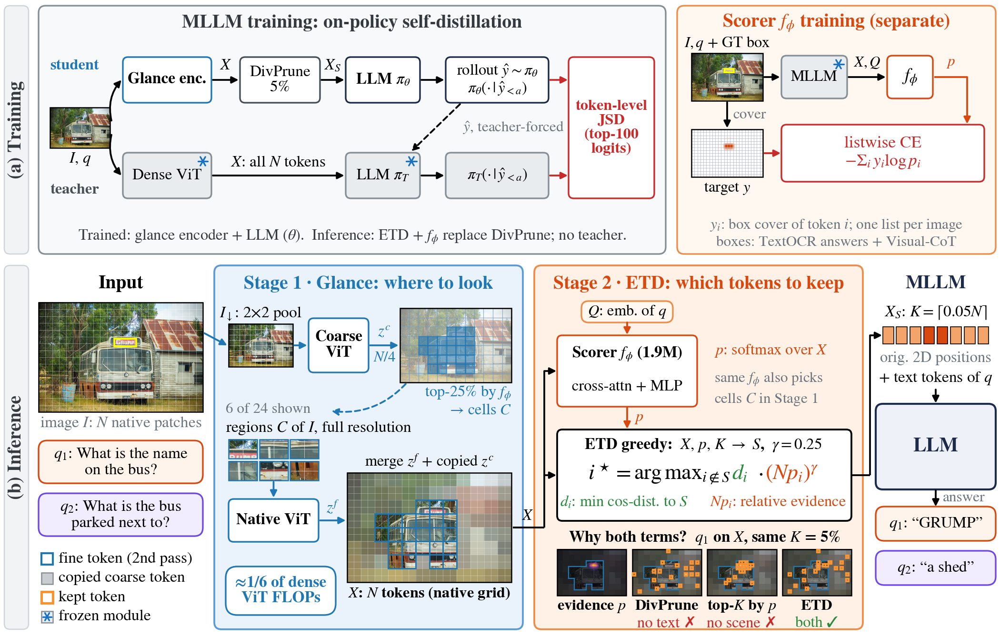

# Glance, then Select: Evidence-Tempered Visual Token Selection for Extremely Compressed Multimodal LLMs

**Yuxuan Wang**<sup>1</sup>, Guangxiang Zhao<sup>2</sup>, Yuxuan Tian<sup>1</sup>, Yahui Han<sup>1</sup>, Xinyu Tan<sup>1</sup>, Feiyu Wang<sup>1</sup>, Zongwei Lv<sup>1</sup>, Xiangzheng Zhang<sup>2</sup>, Lin Sun<sup>2</sup>, Tong Yang<sup>1</sup>

<sup>1</sup>Peking University &nbsp; <sup>2</sup>Qiyuan Tech

Submitted to CVPR 2027. [Project page](https://yxwang1215.top/papers/glance-etd/)

Glance-ETD reduces the visual input of a multimodal LLM in two stages. A glance encoder reads a 2×2-pooled image, keeps the 25% of coarse cells with the highest question relevance, and re-encodes only those cells at native resolution. Evidence-Tempered Diversity (ETD) then keeps a strict budget of tokens, `K = ⌈0.05 N⌉`, by `argmax_i d_i (N p_i)^0.25`: the DivPrune max–min distance `d_i`, weighted by the evidence map `p` of a 1.9M-parameter scorer. The MLLM is trained by on-policy self-distillation with DivPrune selection. The scorer is trained separately on box targets, with the MLLM frozen.

With 5% of the visual tokens, Glance-ETD retains 91.6% of the full-token performance of Qwen3.5-4B across fourteen benchmarks. It is 17.3 points above LT-OPD and 6.0 points above the same training recipe with DivPrune, and it shortens time to first token on 4K images by 3.1×.

<p align="center">
  
</p>

## Layout

| Path | Contents |
|---|---|
| `glance_etd/` | Self-contained PyTorch reference. Only `torch` is required. |
| `scorer/` | TextVQA/TextOCR box grounding, Visual-CoT merge, and scorer training. |
| `training/` | Patch and recipes for the public [LT-OPD](https://github.com/Yrxxxxxxxx1007/LT-OPD) code. |
| `inference/` | Glance-ETD inference on the patched code base, and the `K ∝ N^0.45` scale. |
| `tests/` | CPU checks of the reference implementation. |
| `assets/` | Main figure from the paper. |

`glance_etd/` does not depend on the training framework. The patch, `scorer/` and `inference/` reproduce the experiments. The reference functions were checked on CPU against the code used for the paper: DivPrune and ETD selection, the scorer forward pass, and the glance encoder under both cell rules.

Model checkpoints are not in this repository.

## Quick check

```bash
pip install torch            # tested with torch 2.6
python tests/test_reference.py
```

```python
import torch
from glance_etd import EvidenceScorer, etd_select, strict_budget

tokens = torch.randn(1200, 2560)   # post-merger visual tokens, raster order (gh x gw = 30 x 40)
question = torch.randn(12, 2560)   # input embeddings of the question tokens
scorer = EvidenceScorer().eval()   # or EvidenceScorer.load("selector_epoch3.pt")
rows, cols = torch.arange(1200) // 40, torch.arange(1200) % 40
relevance, _ = scorer(tokens, question, rows, cols, 30, 40)
keep = etd_select(tokens, relevance, strict_budget(1200))   # 60 sorted indices
```

## Reproducing the experiments

The experiment code runs in the environment of the public LT-OPD release: Qwen3.5-4B, `transformers` with Qwen3.5 support, `flash-attn`, and verl/FSDP with Ray. Training used 8×A800. Evaluation used 4×A800.

**1. Code base.** Download the public LT-OPD release and apply the patch from its source root (the directory that contains `learnable_merge/`, `lt_opd/` and `evaluation/`):

```bash
cd LT-OPD/src && patch -p1 < /path/to/Glance-ETD/training/ltopd_glance_etd.patch
```

The patch also keeps training-side options used by the supplementary ablations (`importance.*`, `opd_variant`, and the window encoder). All of them are off by default. Each recipe below sets the options it uses.

**2. Data.** LT-OPD-14K from the LT-OPD release, plus spatial MCQ rows from SAT (static split) and COCO train2017 instances. Images used by GQA test-dev, POPE, MME and CV-Bench are excluded.

```bash
LTOPD_DATA_ROOT=DATA LTOPD_SRC=LT-OPD/src python training/build_spatial_train.py   # -> DATA/data/LT-OPD-14K-spatial
```

**3. MLLM training** (175 steps; about 4.7 h on 8×A800). Train with the final recipe, then export:

```bash
cd LT-OPD/src
python -m lt_opd --implementation current train --model Qwen3.5-4B --data-dir DATA/data/LT-OPD-14K-spatial \
    --output runs/glance_etd --config /path/to/training/configs/glance_etd.yaml
python -m lt_opd --implementation current export --checkpoint runs/glance_etd/global_step_175 \
    --base-model Qwen3.5-4B --output exports/glance_etd
```

`glance_etd_seed{1,2}.yaml` are the seed repeats. `dense_lr10x*.yaml` is the dense-encoder variant. `dense_lr1x.yaml` and `glance_lr1x.yaml` are the component ablations at the LT-OPD vision learning rate.

**4. Evidence scorer** (frozen Qwen3.5-4B; one GPU):

```bash
python scorer/build_boxes.py TextVQA_0.5.1_train.json TextOCR_0.1_train.json DATA/data/benchmarks/textocr/textvqa_train_boxes.json
python scorer/build_boxes.py TextVQA_0.5.1_val.json   TextOCR_0.1_val.json   DATA/data/benchmarks/textocr/textvqa_val_boxes.json
python scorer/build_selector_data.py DATA        # TextVQA/TextOCR + Visual-CoT boxes -> DATA/data/selector_train
python scorer/train_selector.py scorer_out --root DATA --model Qwen3.5-4B \
    --data DATA/data/selector_train --epochs 3 --samples-per-epoch 60000 --general-weight 0.3
```

The scorer is trained once on the untrained model's features and shared by all Qwen models. `--no-question` trains the question-agnostic scorer reported in the supplementary.

**5. Inference.** Run once per benchmark shard, with batch size 1, then score with the LT-OPD scorer:

```bash
export LTOPD_SRC=LT-OPD/src GLANCE_ETD_SCORER=scorer_out/selector_epoch3.pt
python inference/glance_etd_runtime.py --dataset textvqa --export-dir exports/glance_etd \
    --data-config DATA/data/benchmarks/datasets.json --output-dir results/glance_etd/textvqa --rank 0 --world-size 1
python -m lt_opd score --dataset textvqa --predictions results/glance_etd/textvqa --sources DATA/data/scorers \
    --output results/glance_etd/textvqa-score.json
```

| Variable | Default | Meaning |
|---|---|---|
| `GLANCE_ETD_BUDGET` | `ratio` | `ratio` = strict `K = ⌈rN⌉`; `floor` = `max(32, ⌈rN⌉)`; `power` = `K ∝ N^0.45` |
| `GLANCE_ETD_RATIO` | `0.05` | Retention ratio `r` |
| `GLANCE_ETD_SCALE` | – | Scale of the `power` rule (`inference/power_scale.py`) |
| `GLANCE_ETD_GAMMA` | `0.25` | ETD exponent γ |
| `GLANCE_ETD_STAGE1` | `scorer` | `diversity` uses the training-time cell rule |
| `GLANCE_ETD_SELECT` | `etd` | `divprune` keeps the same per-image `K` with DivPrune |

On a dense-encoder model the Stage-1 switch has no effect. Every selector keeps the same `K` per image and passes the kept tokens to the LLM with their original M-RoPE positions.

## Citation

```bibtex
@inproceedings{wang2026glanceetd,
  title     = {Glance, then Select: Evidence-Tempered Visual Token Selection for Extremely Compressed Multimodal LLMs},
  author    = {Wang, Yuxuan and Zhao, Guangxiang and Tian, Yuxuan and Han, Yahui and Tan, Xinyu and Wang, Feiyu and Lv, Zongwei and Zhang, Xiangzheng and Sun, Lin and Yang, Tong},
  booktitle = {Proceedings of the IEEE/CVF Conference on Computer Vision and Pattern Recognition},
  year      = {2027}
}
```

## License

Apache-2.0. See `LICENSE` and `NOTICE`. The training patch is a modification of the public LT-OPD release and does not relicense that upstream code, third-party datasets, or model weights.
